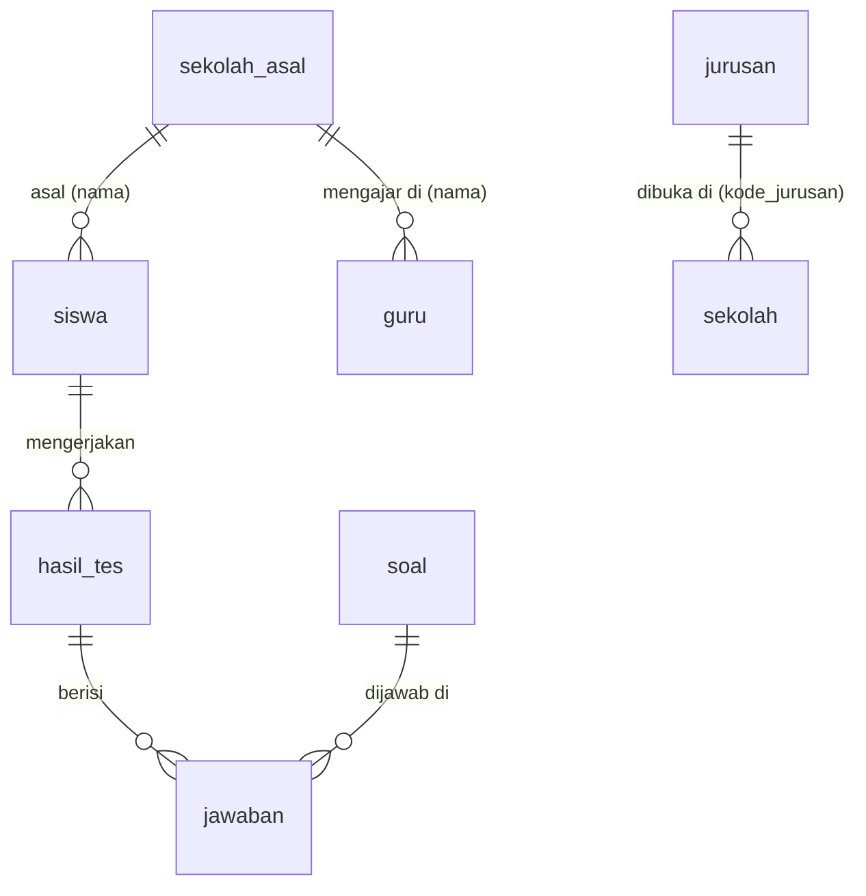

# Database (SQLite)

File database: `backend/data/apajurusanku.sqlite` (dibuat otomatis). Skema ada di
`backend/src/basisdata/migrasi/001_skema.js`.

| Tabel | Kolom penting |
|---|---|
| `jurusan` | **kode** (PK), nama, kode_riasec (huruf pertama = tipe utama), deskripsi, pembelajaran, prospek_kerja, lanjut_kuliah |
| `soal` | id, urutan, pertanyaan, teks_a, tipe_a, gambar_a, teks_b, tipe_b, gambar_b |
| `sekolah` | id, npsn (unik), nama, kota, alamat, latitude, longitude, akreditasi, keterangan, favorit (0/1), kode_jurusan (`RPL,TKJ`), url_instagram, url_tiktok, url_spmb |
| `sekolah_asal` | id, nama (unik), kota |
| `siswa` | id, nisn (unik), nama, sekolah_asal |
| `guru` | id, nama, email (unik), sekolah_asal |
| `admin` | id, username (unik), kata_sandi_hash (bcrypt) |
| `hasil_tes` | id, siswa_id, skor_tipe (JSON), ranking_jurusan (JSON), dibuat_pada |
| `jawaban` | id, hasil_tes_id, soal_id, tipe_dipilih |

Relasi `siswa`/`guru` ↔ `sekolah_asal` memakai **nama sekolah** (teks) agar data mudah diimpor dan dibaca.
`sekolah` ↔ `jurusan` memakai daftar kode dipisah koma agar admin cukup mengetik satu kolom.

## Rumus hasil tes

1. Hitung berapa kali tiap tipe RIASEC (R, I, A, S, E, C) dipilih.
2. Skor jurusan = Σ skor tipe × bobot (tipe pertama di `kode_riasec` bobot 2, sisanya 1).
3. Urutkan; jurusan teratas = 95%, lainnya proporsional. Kode: `src/layanan/hitungHasilTes.js`.
